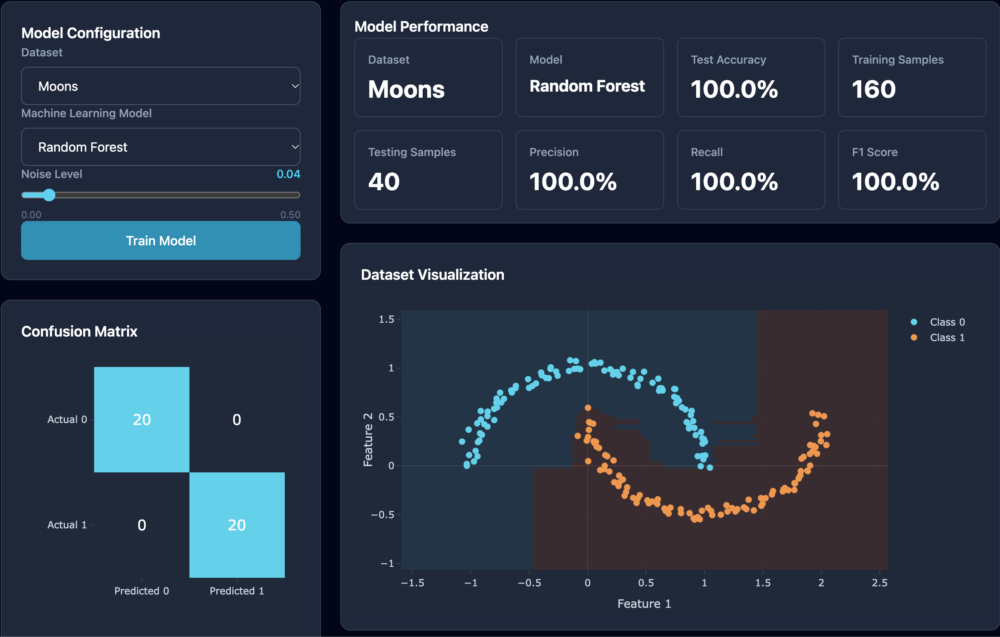

# ML Playground

**An interactive machine learning playground built with React, FastAPI, and scikit-learn.**

ML Playground is a full-stack web application that allows users to explore machine learning classification algorithms through interactive visualizations. Users can generate synthetic datasets, train classification models, inspect decision boundaries, and evaluate model performance.

The project demonstrates the integration of a modern React frontend with a Python-based machine learning backend through a REST API.

## Features

- **Interactive dataset generation:** Explore Moons, Circles, and Blobs datasets.
- **Machine learning models:** Train Logistic Regression, Decision Tree, and Random Forest classifiers.
- **Adjustable noise:** Experiment with different levels of dataset complexity.
- **Decision boundary visualization:** Understand how different algorithms classify observations.
- **Model evaluation:** Analyze accuracy, precision, recall, F1-score, and confusion matrices.
- **Responsive interface:** Explore experiments through a dashboard built with React and Tailwind CSS.
- **Automated testing:** Validate dataset generation, model training, and API behavior using pytest.

## Application Preview



## Technology Stack

| Layer             | Technology                 |
| ----------------- | -------------------------- |
| Frontend          | React, JavaScript, Vite    |
| Styling           | Tailwind CSS               |
| Visualization     | Plotly.js, react-plotly.js |
| Backend           | Python, FastAPI            |
| Machine Learning  | scikit-learn, NumPy        |
| Data Validation   | Pydantic                   |
| Testing           | pytest, HTTPX              |
| API Communication | REST API, JSON             |
| Version Control   | Git, GitHub                |

## Architecture

The application consists of two independent components:

**Frontend (React)**

- Manages user inputs and application state.
- Sends experiment configurations to the backend.
- Displays datasets, model predictions, decision boundaries, and evaluation metrics.
- Handles loading states and API errors.

**Backend (FastAPI)**

- Validates incoming requests using Pydantic schemas.
- Generates synthetic datasets using scikit-learn.
- Splits data into training and testing subsets.
- Trains the selected classification algorithm.
- Calculates classification metrics.
- Generates decision boundary predictions over a two-dimensional mesh grid.
- Serializes results into JSON for frontend visualization.

### Data Flow

```text
User
  |
  v
React Frontend
  |
  | POST /train
  | Dataset, Model, Noise, Samples
  v
FastAPI Backend
  |
  +--> Pydantic Request Validation
  |
  +--> Dataset Generation
  |
  +--> Train/Test Split
  |
  +--> Model Training
  |
  +--> Model Evaluation
  |
  +--> Decision Boundary Generation
  |
  v
JSON Response
  |
  v
React Dashboard
  |
  +--> Dataset Visualization
  +--> Decision Boundary
  +--> Performance Metrics
  +--> Confusion Matrix
```

## Supported Machine Learning Algorithms

| Algorithm           | Description                                            |
| ------------------- | ------------------------------------------------------ |
| Logistic Regression | Linear classification model useful as a baseline       |
| Decision Tree       | Nonlinear classifier based on recursive feature splits |
| Random Forest       | Ensemble classifier combining multiple decision trees  |

All models are trained on generated datasets with a reproducible random seed.

The application uses an 80/20 training and testing split with stratification.

## Project Structure

```text
ml-playground/
├── backend/
│   ├── main.py
│   ├── schemas.py
│   ├── requirements.txt
│   ├── requirements-dev.txt
│   ├── ml/
│   │   ├── datasets.py
│   │   ├── training.py
│   │   ├── decision_boundary.py
│   │   └── serializers.py
│   └── tests/
│       ├── test_datasets.py
│       ├── test_training.py
│       └── test_api.py
│
├── frontend/
│   ├── src/
│   │   ├── components/
│   │   ├── services/
│   │   └── App.jsx
│   └── package.json
│
├── .gitignore
└── README.md
```

## Getting Started

### Prerequisites

- Python with a version compatible with the pinned backend dependencies
- Node.js and npm
- Git

### 1. Clone the Repository

```bash
git clone https://github.com/YOUR_USERNAME/ml-playground.git
cd ml-playground
```

Replace `YOUR_USERNAME` with the actual GitHub username.

### 2. Start the Backend

Navigate to the backend directory:

```bash
cd backend
```

Create and activate a virtual environment:

```bash
python3 -m venv .venv
source .venv/bin/activate
```

Install dependencies:

```bash
python -m pip install -r requirements.txt
```

Start FastAPI:

```bash
uvicorn main:app --reload
```

The backend will be available at:

`http://localhost:8000`

Interactive API documentation:

`http://localhost:8000/docs`

### 3. Start the Frontend

Open another terminal and navigate to the frontend directory:

```bash
cd frontend
```

Install dependencies:

```bash
npm install
```

Create a `.env.development` file:

```env
VITE_API_URL=http://localhost:8000
```

Start the React development server:

```bash
npm run dev
```

Open the local URL displayed in the terminal, typically:

`http://localhost:5173`

## API Endpoints

### GET `/datasets`

Generates a synthetic dataset using the supplied query parameters.

Example:

```http
GET /datasets?type=moons&noise=0.2&samples=200
```

### POST `/train`

Generates a dataset, trains a classifier, evaluates its performance, and returns visualization data.

Example request:

```json
{
  "dataset": "moons",
  "model": "randomForest",
  "noise": 0.2,
  "samples": 200
}
```

The response includes:

- Dataset points and class labels
- Selected dataset and model
- Accuracy, precision, recall, and F1-score
- Training and testing sample counts
- Confusion matrix
- Decision boundary coordinates and predicted classes

Interactive endpoint documentation is available through FastAPI Swagger UI at `/docs`.

## Automated Testing

The backend includes automated tests covering:

- Dataset dimensions and class labels
- Multiple dataset configurations
- Reproducibility of generated datasets
- Model training and evaluation metrics
- Confusion matrix consistency
- API response validation
- Invalid API requests

To run the full suite:

```bash
cd backend
python -m pip install -r requirements-dev.txt
python -m pytest -v
```

## Deployment

Cloud deployment is planned using:

- **Frontend:** Vercel
- **Backend:** Render

The frontend supports environment-based API configuration through `VITE_API_URL`.

Production deployment links will be added once available.

## Future Improvements

Potential enhancements include:

- Model hyperparameter controls
- Side-by-side model comparison
- Additional classification algorithms
- More dataset generation options
- Experiment history and result comparison
- Expanded automated testing

## Purpose

ML Playground was developed as a hands-on project to combine machine learning, backend development, and modern frontend technologies.

The project focuses on building an end-to-end application rather than working exclusively inside notebooks. It demonstrates how machine learning workflows can be exposed through REST APIs and integrated into interactive user interfaces.

## License

No license has been selected yet.
